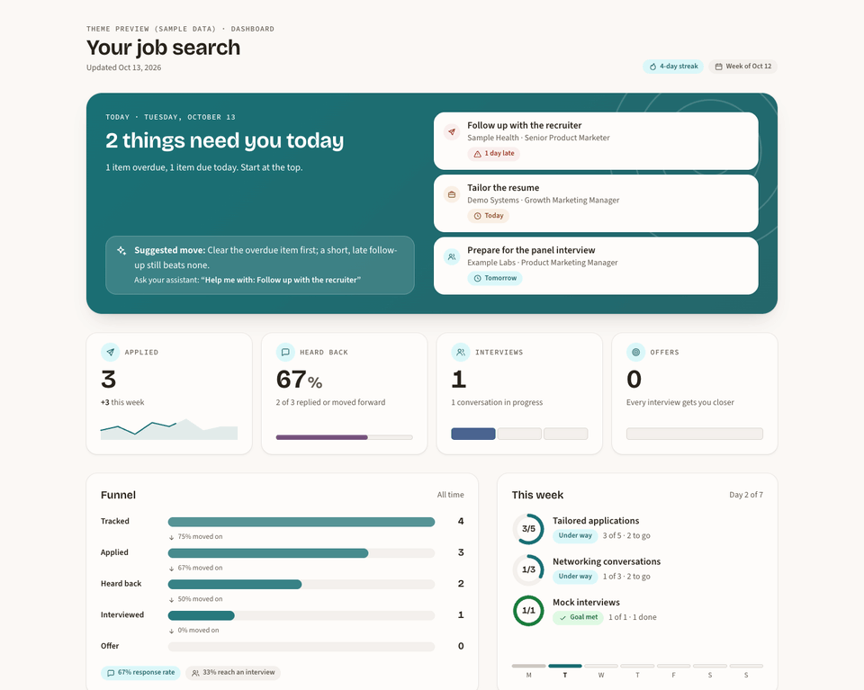
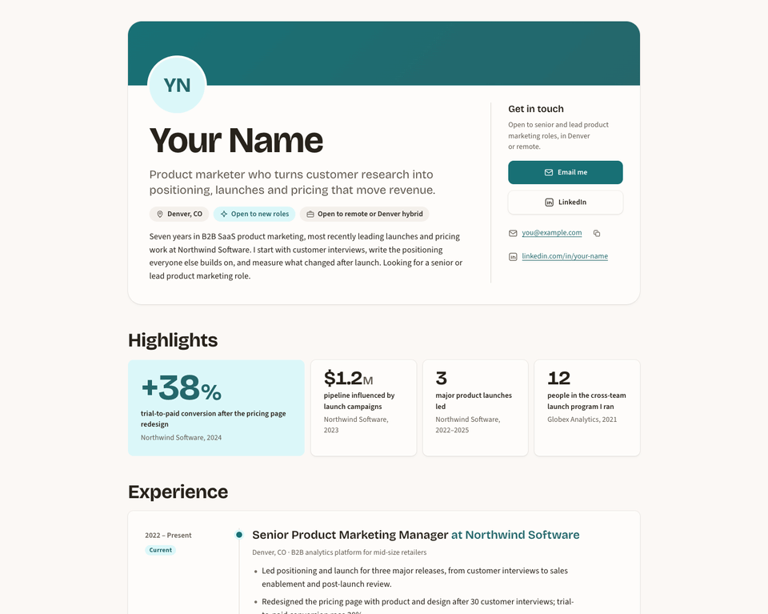
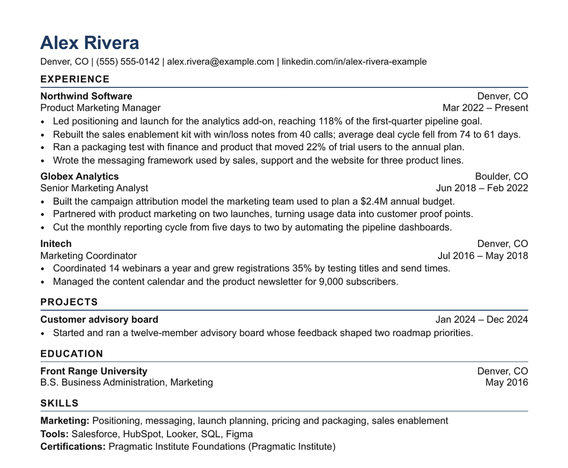

# Job Search HQ

**An AI job-search partner that works from your real experience. You send everything.**

Job Search HQ is a folder you download and open in an AI app: **Claude** (the Claude desktop app or Claude Code) or **Codex** (in the ChatGPT desktop app or the terminal). You talk to it in plain words. It finds jobs that fit you, writes resumes and cover letters from your real experience, keeps track of every application, runs mock interviews, and drafts follow-ups. Nothing gets sent or submitted unless you do it yourself.

**Is it for you?** If you're looking for work, probably: students, new grads, experienced professionals, career changers and people returning to work, in any field and any country. You don't need to know how to code. You need a computer and a Claude or ChatGPT plan that includes Claude Code or Codex ([what you need](#what-you-need)).

**[Quick start](#quick-start)** · [What to say](#what-to-say-once-youre-set-up) · [If something goes wrong](#if-something-goes-wrong) · [Full setup guide](docs/getting-started.md) · [How it works](HOW-IT-WORKS.md) · [Privacy](#your-privacy) · [FAQ](#faq)

<table>
<tr>
<td width="33%"></td>
<td width="33%"></td>
<td width="33%"></td>
</tr>
<tr>
<td align="center">Your dashboard</td>
<td align="center">Your portfolio site</td>
<td align="center">A tailored resume</td>
</tr>
</table>

Screenshots use made-up sample data (Alex Rivera, a fictional product marketing manager).

### Watch the 70-second trailer

https://github.com/user-attachments/assets/d8f7bc63-ce08-40f8-b45c-4405b96cf07f

Made with made-up sample data and a recreated version of the app, so real screens may look different. The panels are built on Claude Code mods, a new feature that may change.

Trailer transcript

Looking for work is a second job. Job Search HQ keeps track of all of it. Every job, every next step, on a board that saves to a spreadsheet you own. It finds openings that fit you, and writes your resume from your real experience. Nothing made up. Applications go faster, with every answer ready to copy. It drafts your follow-ups. You send them. Practice interviews out loud, with a clock and a scorecard, and take your prep with you. Works in Claude or ChatGPT, in plain words. No coding. Job Search HQ. Try it with sample data first.

The board, the panels and read-aloud interviews are in Claude; Codex does the same in the chat.

## What it does

- **Helps you work out what you want** if you're not sure yet: what gives you energy, a few possible directions, and small real experiments to test them (`/explore`, a Life Design method drawn from Stanford, Johns Hopkins and research on career change).
- **Finds jobs that fit you** and sorts out scams and stale postings, then saves every detail of the ones you like before the posting disappears.
- **Writes from your real experience.** Resumes and cover letters are built from your own master resume, fact-checked against it, and saved as ready-to-send PDFs.
- **Keeps track of everything:** a tracker that opens in Excel, a live job board, follow-up dates, and a networking list.
- **Drafts every message** (follow-ups, thank-you notes, referral asks) into an Outbox. You read, edit and send them yourself.
- **Prepares you for interviews** with a company brief, your best stories, and spoken mock interviews with a timer and a scorecard.
- **Helps with the hard parts:** offers and negotiation, a dated plan after a layoff, the weekly record unemployment benefits ask for, and applications in other languages.
- **Shows it all in pages you open in your browser:** a dashboard, flashcards, a portfolio site and a printable interview brief, in a look you choose.

## What it won't do

- **Send anything on its own.** Emails and LinkedIn messages wait as drafts in your Outbox, and you send them. (In Claude you can turn on a send mode; you still press Send and confirm.)
- **Submit applications.** It prepares everything and you submit. Mass applying is left out on purpose. (An optional assisted mode lets it fill in a form in the app's built-in browser; it still stops before Submit unless you type "submit it".)
- **Make things up.** Every fact in a resume, letter or answer comes from your master resume or from what you told it. If a job wants a skill you don't have, it says so.
- **Touch LinkedIn for you.** No clicking, connecting, messaging or scraping there: LinkedIn bans accounts for that. It drafts; you paste.
- **Post anything for you.** Not on GitHub either: when you share what worked in your search, it drafts anonymous notes and you post them yourself, if you want.
- **Keep your ID numbers, date of birth, bank details or passwords.**
- **Phone home.** No server, no account, no telemetry. The AI company running the app does see what the assistant reads: see [Your privacy](#your-privacy).

A safety check backs up these rules in both apps. Here's [what it covers, and what it doesn't](#what-the-safety-check-covers).

## What you need

- **An AI app, on a plan that includes it.** Either one works, and you can use both:
  - **Claude:** the [Claude desktop app](https://claude.com/download) (its **Code** tab) or [Claude Code in the terminal](https://code.claude.com/docs/en/setup), on a paid Claude plan (Pro or above: the Free plan doesn't include Claude Code). Needs macOS 13 or later, or Windows 10 or later.
  - **Codex:** the ChatGPT desktop app or the Codex terminal app, from OpenAI's [Codex quickstart](https://learn.chatgpt.com/docs/quickstart), on a ChatGPT plan that includes Codex (the Free plan has a limited version). The desktop app's Mac download is for Apple silicon (M1 or later); on an older Intel Mac, use the terminal app.

  Which plans include them changes often, so check [Claude plans](https://claude.com/pricing) or [Codex plans](https://learn.chatgpt.com/docs/pricing). Either way you sign in with your account the first time. Keep the app updated.
- **On Windows, for Claude: [Git for Windows](https://git-scm.com/install/windows).** Install it first (click Next through every screen, then restart). Claude itself can run without it, but this folder's safety check runs on Git Bash. Codex doesn't need it.
- **Your current resume** (PDF, Word or text), with your date of birth, ID numbers and bank details taken out. No resume yet? Setup can build one from a short conversation.
- **About 25 minutes** the first time: 5 to open the folder, 15 to 20 for the setup chat. You can stop and pick up later.

Optional, and you can add them any time:

- **Google Chrome or Microsoft Edge** lets the assistant turn resumes and cover letters into PDFs and check they fit on one page. Without one, you open the file and use Print → Save as PDF, and the assistant walks you through it.
- **[Node.js](https://nodejs.org)** (the LTS version) is needed only to change the look of your pages (and, in Claude, to publish your dashboard as a Claude Dashboard). Everything else works without it.
- **Gmail and Google Calendar**, so the assistant can spot recruiter replies, put drafts in your Gmail and add interviews to your calendar. You connect them yourself: see [Optional connections](docs/getting-started.md#optional-connections).

## Quick start

**1. Download the app: [job-search-hq.zip](https://github.com/ClarvAI/job-search-hq/releases/latest/download/job-search-hq.zip).** That link always gets the newest version. (Or open the [latest release](https://github.com/ClarvAI/job-search-hq/releases/latest) and pick `job-search-hq.zip` under **Assets**; skip "Source code (zip)", which GitHub adds for developers. Comfortable with git? `git clone` works too.)

**2. Unzip it and put it somewhere you'll keep it,** like Documents.

- **Mac:** double-click the zip.
- **Windows:** right-click the zip → **Properties** → tick **Unblock** → **OK**. Then right-click it → **Extract All**. (Double-clicking only opens a preview, and Windows can block the folder's scripts if you skip Unblock.)

Open the folder and check that you can see `README.md`, `AGENTS.md` and `CLAUDE.md` directly inside it. If you see a single folder instead (Windows often makes a folder inside a folder of the same name), use the inner one. This matters: opened one level up or down, the assistant doesn't get its rules and the safety check doesn't run. Put your resume in its `imports` folder.

**3. Open the folder in your AI app, and trust it.**

- **Claude desktop app** ([download](https://claude.com/download); on Windows, install [Git for Windows](https://git-scm.com/install/windows) first): sign in and open the **Code** tab. In the row under the message box, pick the top entry under **Local** (not Cloud), then use the folder button next to it → **Open folder…** → pick the folder. If Claude asks whether you trust it, click **Trust**. If the mode selector shows **Manual**, switch it to **Auto** so Claude doesn't ask before every step.
- **Codex in the ChatGPT desktop app** ([download](https://learn.chatgpt.com/docs/quickstart)): sign in, choose **Codex** from the ChatGPT dropdown, and add the folder as a new local project (if the project has several folders, make this one the **primary** folder). Say yes if it asks whether to trust the folder, and at **Hooks need review** choose **Trust all and continue**.
- **Terminal:** install [Claude Code](https://code.claude.com/docs/en/setup) or the Codex CLI (from the [Codex quickstart](https://learn.chatgpt.com/docs/quickstart)), open a new terminal window in the folder, and run `claude` or `codex`. The first run asks you to sign in. Trust the folder when asked. In Codex, also approve its hooks with `/hooks`.

What "trust" means: it lets the app use this folder's own settings, including the safety check that stops the assistant from sending email, the daily greeting and (in Claude) the panels. If you don't trust the folder, they stay off, and Codex also ignores the assistant's rules.

**4. Start setup.** In Claude, type **`/start`** and press Enter. In Codex, type **set me up** (or `$start`).

> **Check:** as you type `/` in Claude (or `$` in Codex), `start` should show in the list. If it doesn't, you opened the wrong folder: go back to step 2.

**What you'll see:** a short welcome, then a request for your resume. Setup is a conversation of about 14 short questions: where your search stands, what you're looking for (roles, places, pay, deal-breakers) and a story or two in your own words. It also builds a starter pack about your field: the words its job postings use, and employers to look at. Before it saves anything about you, it shows you the exact lines and asks "OK to save?". In Claude, saving your resume facts or preferences also shows a small permission box (a few times during setup, rarely after): that's a deliberate second lock on your source of truth, so choose Yes when it matches what you just approved. Everything else, like job folders, the tracker and drafts, is saved without asking. Setup ends with a short plan for your first week. If you stop partway, it picks up where you left off next time.

**Want to look around first?** Ask for **the sample workspace**: a separate practice copy filled with a made-up job search (Alex Rivera), so you can try the boards and pages before you share anything. Your own folder isn't touched.

Every step with more detail, for both apps, plus voice and the panels: **[docs/getting-started.md](docs/getting-started.md)**.

## What to say once you're set up

Take the 10-minute **tour** first (`/tour` in Claude, `$tour` in Codex), then start each day with **today**. You never need the commands: plain words work, typed or spoken.

| Say | What happens |
|---|---|
| "What should I do today?" | What's due, what's new, and three suggested moves |
| Paste a job link | It saves the posting, checks the fit and for scam signs, adds it to your tracker, and gets the application ready if it's a good fit |
| "Find me operations analyst jobs near Austin" | Searches for openings that fit you |
| "Tailor my resume for the Acme job" | A resume for that job, fact-checked against your real experience, saved in the job's folder |
| "It's been 10 days and I haven't heard back from Acme" | Drafts the follow-up into your Outbox |
| "Help me prep for my Acme interview Thursday" | A company brief, likely questions, your best stories and questions to ask |
| "Mock interview for Acme" | A spoken practice interview with a timer and a scorecard |
| "I applied to Acme yesterday" | Updates your tracker and sets the next follow-up date |
| "Show my board" or "show my outbox" | Your jobs by stage, or the drafts waiting for you |
| "I'm not sure what I want to do next" | Explores what matters to you, three possible directions, and small ways to try each one |
| "Back up my stuff" | A dated zip of everything |
| "Set up automatic checks" | New jobs each morning, an inbox check or follow-up drafts on a schedule, on your own computer (opt-in; they only read, draft and track) |

Every shortcut is listed in [the guide](docs/getting-started.md#what-you-can-do). Not sure what to ask? Type "I'm lost" or `/menu`.

## Works with

| App | What you get | What's missing | Setup |
|---|---|---|---|
| **Claude Code** in the Claude desktop app (Code tab) or the terminal | Everything: every workflow, review agents, the safety check, panels, read-aloud mock interviews, voice | Nothing | [Quick start](#quick-start) |
| **Codex** in the ChatGPT desktop app, the terminal or an editor | Every workflow (panels happen in the chat), the safety check once you trust its hooks, voice chat in the desktop app | Panels, publishing pages as links; the terminal and editor have no built-in browser | [Quick start](#quick-start) |
| A regular Claude chat with a folder attached (formerly Cowork) | Not supported: it runs tasks in the cloud with the skills from your claude.ai account, not this folder's workflows, safety check or permission rules | Use the Code tab of the same app instead | [platforms.md](docs/platforms.md) |
| Other assistants that read `AGENTS.md` (Cursor, GitHub Copilot, Gemini CLI, Grok Build, Muse Code and others) | The written rules, and the workflows where the app reads skill folders | The safety check, panels; best effort only | [platforms.md](docs/platforms.md) |
| Personal assistant apps (Meta Muse, Grok Bot, Instinct and similar) | Not supported: they don't use this folder's rules, workflows or safety check | Use Claude Code or Codex instead | [platforms.md](docs/platforms.md) |

The details, app by app, including where the safety check doesn't run: **[docs/platforms.md](docs/platforms.md)**.

## How it works

In words: you talk to the assistant; it reads and updates your files (master resume, tracker, contacts, drafts); panels (in Claude), the chat (in Codex) and pages in your browser show them; a safety check stops the assistant's own attempts to send, post or delete; and you send and submit everything yourself. More in [HOW-IT-WORKS.md](HOW-IT-WORKS.md).

**Under the hood** (for the technically curious): Job Search HQ turns Claude Code or Codex into a job-search assistant with agent skills (`SKILL.md` workflows in `.claude/skills/`, shared with Codex through `.agents/skills/`), shared rules (`AGENTS.md`, `CLAUDE.md`), review subagents (`.claude/agents/`, `.codex/agents/`), safety hooks for both apps, Claude Code mods (the panels), Codex settings and rules (`.codex/`), and HTML templates for the pages, resumes and cover letters. It has no server and no code of its own beyond small shell, PowerShell and Node scripts. Details: [HOW-IT-WORKS.md](HOW-IT-WORKS.md) and [CONTRIBUTING.md](CONTRIBUTING.md).

## If something goes wrong

- **`start` isn't in the list when you type `/` (or `$` in Codex).** You opened the wrong folder, often the outer one of two folders with the same name. Open the one with `README.md`, `AGENTS.md` and `CLAUDE.md` directly inside it, and trust it.
- **On Windows, with Claude, you skipped Git for Windows.** Then the safety check doesn't run. Install it, restart, and reopen the folder. Type `/health` to confirm; it also finds files Windows blocked because Unblock was skipped, and offers to fix them.
- **No panels in Claude.** Check that you opened the top folder and clicked **Trust**, and update the app. You don't need them, though: say "show my board", "show my outbox" or "mock interview" and Claude does the same in the chat.
- **Codex doesn't greet you with today's date and your search.** Its hooks aren't on, which means its safety check is off too. Type `/hooks`, trust them, and start a new chat. Do it again after an update that changes them.
- **You hit a usage limit partway through.** What's done is already saved in the folder. After the limit resets, say "carry on with the Acme resume" and it picks up from what's there.
- **Anything else:** type `/health` (`$health` in Codex). It checks the folder, the app version, the safety check, the panels and your connections, changes nothing, and tells you the one thing to fix first. More fixes are in [the guide](docs/getting-started.md#if-something-looks-off).

## Your privacy

- **No server, no account, no telemetry.** Job Search HQ is files and small scripts on your computer. It doesn't phone home.
- **The AI company sees what the assistant reads.** Your resume, tracker and messages are sent to Anthropic (Claude) or OpenAI (Codex) when the assistant works with them, under that company's terms and your plan's privacy settings. Check whether your plan lets them train on your chats, and turn that off if you want.
- **Everything else is your choice.** Gmail, Google Calendar, a browser, publishing a page as a private link, and a cloud-synced folder each share data with that service, and only if you turn them on. Web searches send the search words.
- **Your pages work offline.** The fonts and small libraries they use come with the app ([THIRD_PARTY_NOTICES.md](THIRD_PARTY_NOTICES.md)). Only a page you publish or move out of this folder, and the few fonts the app can't include (Lexend for the High contrast look, the Lato resume font, a brand font you bring), are fetched from Google Fonts or jsDelivr.

Every place your data can go, app by app: **[docs/privacy.md](docs/privacy.md)**.

## Your data stays yours

- **Two kinds of files.** Your files (profile, jobs, contacts, drafts, notes, pages) are never part of the app's download or its git history. The app's files are everything else. [DATA_CONTRACT.md](DATA_CONTRACT.md) has the exact list.
- **Updates never touch your files.** They replace only the app's files, keep your edited copy of any app file next to it, and can be undone.
- **Back up with one sentence.** Say "back up my stuff" (`/my-data`) for a dated zip of everything. Keep a copy somewhere other than this computer. The same command wraps up your search when you get the job, or wipes the folder for a fresh start.
- **Keep it out of public places.** If you ever put this folder in git, use a private repository only: it holds other people's contact details, references and offer terms. Setup offers a git hook that stops pushes to a public GitHub repository.

## What the safety check covers

The main protection is that the assistant drafts and you send. Under the assistant's rules sits a safety check (a "hook") that looks at certain actions before they run, in both apps. In short, it blocks sending, posting and deleting through your connected apps, calendar invites, automated browsing of Gmail, Outlook and LinkedIn, and pushing this folder to a public GitHub repository. If the check crashes or is missing, the action is blocked.

<b>Everything it blocks, when the assistant asks you first, and what the check doesn't cover</b>

It blocks:

- sending, replying, forwarding, posting, sharing or deleting through the Gmail connection or any other connected app (making drafts is fine);
- inviting people to calendar events or meetings (Google Calendar, Outlook, Calendly, Zoom and similar), or changing, cancelling or deleting them;
- adding, changing or removing who can see or join something in a connected app (collaborators, guests, members, permissions);
- automation services (IFTTT, Zapier, n8n and similar) doing anything but read, writing to a contacts app, pushing contacts to another service, or sending feedback to an app's maker: Claude asks you first, Codex blocks;
- sending an automated browser to Gmail, Outlook or LinkedIn, including through short links or a script run on the page;
- sending mail from the computer itself (the Mail app, Outlook, mail commands) or opening Gmail, Outlook or LinkedIn from a command;
- in Claude, web addresses that look like they carry your email, phone, name or large blocks of data (a pattern check that can't catch every disguise);
- pushing this folder to a public GitHub repository, creating or uploading to a public repository, release or gist, or making one public, including through git aliases, saved address rewrites, remote or settings changes in the same command, a script started with `bash -c` or PowerShell's `-Command`, or text piped into a shell. A push from a folder it can't find is blocked too.

In Claude, the main email and calendar actions (send, reply, forward, delete, respond, change) are also switched off in the folder's permission settings, so they stay blocked even if the check can't run. If the check crashes or is missing, the action is blocked. If it takes too long (30 seconds): Claude Code 2.1.295 or later blocks the action, older versions and Codex let it go ahead.

In the terminal, Claude starts in auto mode: it works without asking about routine steps, and a separate reviewer checks its actions. It still asks before changing your profile or preferences with a command, before undoing an update, and for anything the settings mark "ask". If it asks before almost every step instead, the session is in Manual mode (an older version, your organization's settings, or a choice made earlier): press Shift+Tab until it shows auto mode. In the desktop app, pick **Auto** in the Code tab's mode selector if it shows **Manual**; the app remembers the choice for this folder (`/health` also checks this). Codex, in a trusted folder, edits and runs things in this folder without asking, makes PDFs without asking, and asks before going online or saving outside the folder (a backup, for example).

What the check doesn't cover:

- **Claude:** it runs only when you open the top folder and trust it. On Windows it needs Git for Windows; without it the check doesn't run (the permission settings above still block the main email and calendar actions), so install Git for Windows first. It doesn't check file edits or web searches.
- **Codex:** it runs only after you trust the folder and the hooks (`/hooks`), and again after they change, for example after an update. It doesn't check file edits or Codex's built-in web search, and some Codex tool paths skip hooks.
- **Other apps** (a regular Claude chat with a folder, Cursor, Copilot, Gemini CLI and the rest): the check doesn't run there at all. The written rules are the only protection. See [docs/platforms.md](docs/platforms.md).
- **Everywhere:** it sees the assistant's requests, not your screen: not clicks in a browser tab that's already open, and not everything a script does. It can't see inside a script saved in a file, and it only knows GitHub: other hosting sites aren't checked. A site that redirects on its own to Gmail, Outlook or LinkedIn, and what the assistant types into a form on any other site, aren't checked either; that part rests on the assistant's rules.

Optional git safety nets: `git config core.hooksPath .githooks` turns on two git hooks. `pre-push` blocks pushes to a public GitHub repository even from a script; `commit-msg` removes AI attribution lines (such as "Co-authored-by: Claude") from your commit messages. Full technical details: [SECURITY.md](SECURITY.md).

## Plans and usage

Job Search HQ is free for personal use; the assistant runs on your own Claude or ChatGPT plan. Which plans include Claude Code or Codex, what they cost and how much use they allow change often, so check the providers directly: [Claude plans](https://claude.com/pricing) and [Codex plans](https://learn.chatgpt.com/docs/pricing).

- **Usage limits:** both apps have usage limits that reset over time, and the app tells you when you're close. If you hit one partway through, what you've done so far is already saved in this folder. Wait for the reset (or use extra usage if your plan offers it), then ask again, for example "carry on with the Acme resume". The assistant checks what's already there and picks up from it.
- **What uses the most:** setting up (`/start`), tailoring a resume (it runs three checks on it), adding a good-fit job with its application package, searching for jobs, and interview prep. Lightest: `/today`, the panels, the Outbox and LinkedIn tips. On a smaller plan, plan one or two big tasks per session.
- **Which model:** the app's default is fine for everyday work. For setup, resumes, cover letters, offers and interview prep, pick the most capable model your plan offers. The smallest, fastest models tend to rush setup and skip steps.
- **Don't set an `ANTHROPIC_API_KEY`** on your computer unless you mean to: Claude Code then bills that key instead of using your plan.

## FAQ

<b>Do I need to know how to code?</b>

No. You type (or say) what you want in plain English. If you're unsure what to ask, type "I'm lost" or `/menu`.

<b>Does it work on Windows?</b>

Yes. For Claude, install [Git for Windows](https://git-scm.com/install/windows) first: Claude can run without it, but this folder's safety check runs on Git Bash. Codex doesn't (its safety scripts run with PowerShell). Unblock the zip before you unzip it, as in [Quick start](#quick-start).

<b>Do I need Excel?</b>

No. Your tracker is a plain spreadsheet file (`jobs/tracker.csv`) that opens in Excel, Numbers or Google Sheets, but you can do everything by talking to the assistant or on the board. If you edit it in Excel, keep dates as YYYY-MM-DD, save as **CSV UTF-8**, and close Excel when you're done. In much of Europe, Excel saves with semicolons, which breaks the file; [the guide](docs/getting-started.md#where-your-stuff-lives) explains the safe way to open it there.

<b>I'm not in the US. Does it still work?</b>

Yes. The assistant talks with you in your own language (setup asks; buttons in Claude's panels stay in English), and when it needs an exact phrase from you, like the one that confirms deleting your data, it shows you that phrase in your language too. Setup asks where you're looking, and resumes follow that country's norms (two-page CVs on A4 where that's usual, no photo or birth date unless you choose). It writes applications in other languages you can check, reads dates the way your spreadsheet writes them, and covers benefits records for the UK's Universal Credit as well as US states.

<b>I'm a student or new grad with little experience.</b>

That's fine. Setup builds your master resume from classes, projects, part-time jobs and activities, and the job search aims at internships and entry-level roles. It helps with career fairs, school job boards like Handshake, and the recorded video interviews many big employers use.

<b>I'm changing careers.</b>

Setup asks what you're moving toward and builds a starter kit for that field (a primer, the words its job postings use, employers to target). Resumes lead with the experience that transfers, in your real job titles, and every gap is shown honestly so you can prepare for it.

<b>My situation is a bit different. Does it still fit?</b>

Probably; just tell the assistant. It has guidance for:
- **searching while you still have a job:** it asks once whether your employer knows, then keeps things quiet (your own devices and accounts, LinkedIn's "recruiters only" setting, no references from current colleagues);
- **hourly, shift and part-time jobs:** fast applications, your availability, and the certificates many of these jobs require;
- **freelance, contract and agency work:** the kinds of contract, comparing rates with salaries, and questions to ask (it never tells you what your tax or legal status will be);
- **academic jobs:** CVs instead of resumes, the full application packet, and campus visits;
- **recruiters and headhunters:** who they work for, how they're paid (never by you), and how to reply;
- **email that isn't Gmail:** in Claude, a work or school Microsoft 365 account can connect read-only; any other inbox works by pasting or saving the emails for it. Don't use your current employer's email for your search.

<b>Can it use my school's alumni network?</b>

Yes. Tell it your school (or a bootcamp, or a past employer), and it shows you how to see where its alumni work and who's at a company you like: you look on LinkedIn or your school's alumni directory and paste back what you see, and it never runs LinkedIn for you. Alumni counts help rank jobs and give you a warm first person to ask.

<b>Can it use my other connected apps?</b>

If you've already connected them to Claude or Codex, yes, read only. Company data like PitchBook adds funding, headcount and leadership to "should I apply?", interview prep and startup offers; Google Drive can bring in your resume; meeting notes can feed a thank-you note (it asks first). It names the source of every figure, keeps licensed data out of anything you publish or send, and warns you if an app looks like your employer's account. None of them is needed.

<b>Can it check for new jobs automatically?</b>

Yes, if you want it to. Say **set up automatic checks** and it suggests one to three routines, such as a morning job scan on weekdays, a daily inbox check, a Friday review or a Monday check that your saved postings are still open, and sets up only the ones you say yes to. If one stops running, the app tells you the next time you open it. They run on your own computer, in the Claude desktop app or the ChatGPT desktop app (Codex), while the app is open, and they only read, draft and track: new leads wait in your Job Inbox and drafts in your Outbox, and nothing is sent or submitted. Each run uses your plan like a short chat, so once a day is plenty. Steps: [the guide](docs/getting-started.md#automatic-checks-routines).

<b>Will it apply to jobs for me?</b>

No. It prepares everything and you submit. Mass applying and LinkedIn automation are left out on purpose: they get accounts banned and rarely work.

## Updating

Say **update** (`/update` in Claude, `$update` in Codex). The assistant fetches the newest release itself, shows you what's new, and asks before installing it. (Have the zip already? Drop it in the `imports` folder and say update.) Only the app's files change; your profile, jobs, contacts, drafts, notes and pages are never touched. If you'd edited one of the app's files, your version is kept next to it as `<file>.local`, and "undo the update" rolls back. If a new version changes the resume or cover-letter templates and you've picked a look, your copies are rebuilt in your look and the old copy is kept as `<name>.previous.html`. In Codex, re-approve the safety hooks (`/hooks`) if the update says they changed. Got the app with git instead? `git pull` works too; say "update" and the assistant does the follow-up steps with you.

## Accessibility

We want everyone to be able to use Job Search HQ, including people who use a screen reader, a keyboard only, dictation, or larger text. We aim for **WCAG 2.2 level AA**, and don't claim full conformance yet, because not everything has been tested with real assistive technology. Every panel works from the keyboard and has a chat version, mock interviews are silent unless you turn voice on, and the pages pass automated accessibility checks. Tell the assistant what's in your way ("I use a screen reader", "please don't time me") and it adjusts.

What was checked, the known limits, and how to report a barrier: **[docs/accessibility.md](docs/accessibility.md)**.

## Contributing

Ideas, bug reports and fixes are welcome. Open an issue in the source repository (please leave out your personal details; the templates say how), and follow the [code of conduct](CODE_OF_CONDUCT.md). How to change, test and release the app is in [CONTRIBUTING.md](CONTRIBUTING.md) (in the source repository; it isn't part of the release zip).

## License and fine print

- [LICENSE](LICENSE): PolyForm Noncommercial 1.0.0. Free for your own job search and any other noncommercial use, and free for schools, career centers, charities and public bodies. You can change it and share it, as long as the license and its `Required Notice` line go with it. Selling it, building it into a paid product, or using it to serve paying clients (for example as a career coach) needs a commercial license from Sam Clarvit; ask in this repository's [Discussions](https://github.com/ClarvAI/job-search-hq/discussions). Because of that limit it is source-available rather than "open source".
- [DISCLAIMER.md](DISCLAIMER.md): not professional advice; AI output can be wrong; you're responsible for what you send.
- [SECURITY.md](SECURITY.md): what the safety checks do and don't cover, and how to report a problem privately.
- [THIRD_PARTY_NOTICES.md](THIRD_PARTY_NOTICES.md): fonts, libraries and other outside pieces the pages use.
