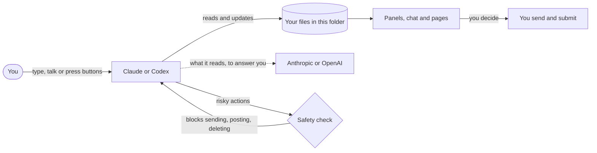

# Job Search HQ

**An AI job-search partner that works from your real experience. You send everything.**

Job Search HQ is a folder you open in an AI assistant: **Claude** (the Claude desktop app or Claude Code) or **Codex** (in the ChatGPT desktop app or the terminal). It finds jobs that fit you, writes resumes and cover letters from your real experience, keeps track of every application, runs mock interviews, and drafts follow-ups. Nothing gets sent or submitted unless you do it yourself. It works for any field and any stage: students, new grads, experienced professionals, career changers, and people returning to work, in any country.

<table>
<tr>
<td width="33%"></td>
<td width="33%"></td>
<td width="33%"></td>
</tr>
<tr>
<td align="center">Your dashboard</td>
<td align="center">Your portfolio site</td>
<td align="center">A tailored resume</td>
</tr>
</table>

Screenshots use made-up sample data (Alex Rivera, a fictional product marketing manager).

## What it does

- **Finds jobs that fit you** and sorts out scams and stale postings, then saves every detail of the ones you like before the posting disappears.
- **Writes from your real experience.** Resumes and cover letters are built from your own master resume, fact-checked against it, and saved as ready-to-send PDFs. It never invents anything.
- **Keeps track of everything:** a tracker that opens in Excel, a live job board, follow-up dates, and a networking list.
- **Drafts every message** (follow-ups, thank-you notes, referral asks) into an Outbox. You read, edit and send them yourself.
- **Prepares you for interviews** with a company brief, your best stories, and spoken mock interviews with a timer and a scorecard.
- **Helps with the hard parts:** offers and negotiation, a dated plan after a layoff, the weekly record unemployment benefits ask for, and applications in other languages.
- **Shows it all in pages you open in your browser:** a dashboard, flashcards, a portfolio site and a printable interview brief, in a look you choose.

## How it works

In words: you talk to the assistant; it reads and updates your files (master resume, tracker, contacts, drafts); panels (in Claude), the chat (in Codex) and pages in your browser show them; a safety check stops the assistant's own attempts to send, post or delete; and you send and submit everything yourself. More in [HOW-IT-WORKS.md](HOW-IT-WORKS.md).

## Works with

| App | What you get | What's missing | Setup |
|---|---|---|---|
| **Claude Code** in the Claude desktop app (Code tab) or the terminal | Everything: every workflow, review agents, the safety check, panels, read-aloud mock interviews, voice | Nothing | [Quick start](#quick-start) |
| **Codex** in the ChatGPT desktop app, the terminal or an editor | Every workflow (panels happen in the chat), the safety check once you trust its hooks, voice chat in the desktop app | Panels, publishing pages as links; the terminal and editor have no built-in browser | [Quick start](#quick-start) |
| A regular Claude chat with a folder attached (formerly Cowork) | Not supported: it now runs tasks on Anthropic's servers and doesn't use this folder's workflows, safety check or permission rules | Use the Code tab of the same app instead | [platforms.md](docs/platforms.md) |
| Other assistants that read `AGENTS.md` (Cursor, GitHub Copilot, Gemini CLI and others) | The written rules, and the workflows where the app reads skill folders | The safety check, panels; best effort only | [platforms.md](docs/platforms.md) |

The details, app by app, including where the safety check doesn't run: **[docs/platforms.md](docs/platforms.md)**.

## Quick start

Before you begin, put your current resume (PDF, Word or text) in the `imports` folder, with your date of birth, ID numbers and bank details removed. No resume yet? Setup can build one from a short conversation. Setup itself is a 15 to 20 minute chat. Want to look around first? Ask for "the sample workspace": a separate copy with Alex Rivera's made-up job search, so you can try the boards and pages before entering anything.

**Claude desktop app** (paid Claude plan; on Windows, install [Git for Windows](https://git-scm.com/download/win) first)

1. Download this folder ([release zip](#updating) or `git clone`) and unzip it somewhere you'll keep it, like Documents.
2. In the Claude desktop app, open the **Code** tab → **Local** → **Open folder** → pick this folder, and click **Trust**.
3. Type **`/start`**.

**Claude Code in the terminal** (paid Claude plan; on Windows, Git for Windows first)

1. Download or clone this folder.
2. Open a terminal in it and run `claude`; trust the folder when asked.
3. Type **`/start`**.

**Codex in the ChatGPT desktop app** (ChatGPT plan; Plus or higher recommended)

1. Download or clone this folder.
2. In the ChatGPT desktop app, switch to **Codex**, add this folder as a local project (as the **primary** folder), trust it, and at **Hooks need review** choose **Trust all and continue**.
3. Type **set me up** (or `$start`).

**Codex in the terminal**: download the folder, run `codex` in it, trust the folder and its hooks (`/hooks`), then type **set me up**.

Always open the folder that has `README.md`, `AGENTS.md` and `CLAUDE.md` directly inside it. Opened one level down, the assistant doesn't get its rules and the safety check doesn't run. The full guide, with the Windows unzip steps, a check that you opened the right folder, every command, the panels and voice: **[docs/getting-started.md](docs/getting-started.md)**. After setup, take the 10-minute **tour** (`/tour` in Claude, `$tour` in Codex), then start each day with **today**.

## Your privacy

- **No server, no account, no telemetry.** Job Search HQ is files and small scripts on your computer. It doesn't phone home.
- **The AI company sees what the assistant reads.** Your resume, tracker and messages are sent to Anthropic (Claude) or OpenAI (Codex) when the assistant works with them, under that company's terms and your plan's privacy settings. Check whether your plan lets them train on your chats, and turn that off if you want.
- **Everything else is your choice.** Gmail, Google Calendar, a browser, publishing a page as a private link, and a cloud-synced folder each share data with that service, and only if you turn them on. Web searches send the search words.
- **Your pages work offline.** The fonts and small libraries they use come with the app ([THIRD_PARTY_NOTICES.md](THIRD_PARTY_NOTICES.md)). Only a page you publish or move out of this folder, and the few fonts the app can't include (Lexend for the High contrast look, the Lato resume font, a brand font you bring), are fetched from Google Fonts or jsDelivr.

Every place your data can go, app by app: **[docs/privacy.md](docs/privacy.md)**.

## Your data stays yours

- **Two kinds of files.** Your files (profile, jobs, contacts, drafts, notes, pages) are never part of the app's download or its git history. The app's files are everything else. [DATA_CONTRACT.md](DATA_CONTRACT.md) has the exact list.
- **Updates never touch your files.** They replace only the app's files, keep your edited copy of any app file next to it, and can be undone.
- **Back up with one sentence.** Say "back up my stuff" (`/my-data`) for a dated zip of everything. Keep a copy somewhere other than this computer. The same command wraps up your search when you get the job, or wipes the folder for a fresh start.
- **Keep it out of public places.** If you ever put this folder in git, use a private repository only: it holds other people's contact details, references and offer terms. Setup offers a git hook that stops pushes to a public GitHub repository.

## What the safety check covers

The main protection is that the assistant drafts and you send. Under the assistant's rules sits a safety check (a "hook") that looks at certain actions before they run, in both apps. It blocks:

- sending, replying, forwarding, posting, sharing or deleting through the Gmail connection or any other connected app (making drafts is fine);
- inviting people to calendar events or meetings, or changing, cancelling or deleting them;
- automation services (IFTTT, Zapier, n8n and similar) doing anything but read: Claude asks you first, Codex blocks;
- sending an automated browser to Gmail, Outlook or LinkedIn, including through short links or a script run on the page;
- sending mail from the computer itself (the Mail app, Outlook, mail commands) or opening Gmail, Outlook or LinkedIn from a command;
- in Claude, web addresses that look like they carry your email, phone, name or large blocks of data (a pattern check that can't catch every disguise);
- pushing this folder to a public GitHub repository, creating or uploading to a public repository, release or gist, or making one public, including through git aliases, remote changes in the same command, or text piped into a shell.

In Claude, the main email and calendar actions (send, reply, forward, delete, respond, change) are also switched off in the folder's permission settings, so they stay blocked even if the check can't run. If the check crashes or is missing, the action is blocked. If it takes too long (30 seconds): Claude Code 2.1.295 or later blocks the action, older versions and Codex let it go ahead.

Claude starts in auto mode: it works without asking about routine steps, and a separate reviewer checks its actions. It still asks before changing your profile or preferences with a command, before undoing an update, and for anything the settings mark "ask". Press Shift+Tab to switch to asking about everything.

What the check doesn't cover:

- **Claude:** it runs only when you open the top folder and trust it. On Windows it needs Git for Windows; without it the check doesn't run (the permission settings above still block the main email and calendar actions), so install Git for Windows first. It doesn't check file edits or web searches.
- **Codex:** it runs only after you trust the folder and the hooks (`/hooks`), and again after they change, for example after an update. It doesn't check file edits or Codex's built-in web search, and some Codex tool paths skip hooks.
- **Other apps** (a regular Claude chat with a folder, Cursor, Copilot, Gemini CLI and the rest): the check doesn't run there at all. The written rules are the only protection. See [docs/platforms.md](docs/platforms.md).
- **Everywhere:** it sees the assistant's requests, not your screen: not clicks in a browser tab that's already open, and not everything a script does. It can't see inside a script saved in a file, and it only knows GitHub: other hosting sites aren't checked. A site that redirects on its own to Gmail, Outlook or LinkedIn, and what the assistant types into a form on any other site, aren't checked either; that part rests on the assistant's rules.

Optional git safety nets: `git config core.hooksPath .githooks` turns on two git hooks. `pre-push` blocks pushes to a public GitHub repository even from a script; `commit-msg` removes AI attribution lines (such as "Co-authored-by: Claude") from your commit messages. Full technical details: [SECURITY.md](SECURITY.md).

## Cost and plans

- **Claude:** Claude Code comes with paid Claude plans: Pro ($20 a month, or $17 a month paid yearly), Max (from $100 a month, with 5 or 20 times Pro's usage), Team and Enterprise. The free plan doesn't include it. Claude Code and your Claude chats share one allowance: a limit for each 5-hour session and a weekly limit. Claude warns you as you get close. ([Claude pricing](https://claude.com/pricing); [Using Claude Code with Pro or Max](https://support.claude.com/en/articles/11145838))
- **Codex:** Codex comes with every ChatGPT plan, including Free and Go ($8 a month), for light use. Plus ($20 a month) or higher is better for a real search. Plus has a limit per 5-hour period and may have a weekly one; Pro (from $100 a month) has no 5-hour limit right now. ([Codex pricing](https://learn.chatgpt.com/docs/pricing))
- **If you hit a limit partway through:** what you've done so far is already saved in this folder. Wait for the reset (or turn on extra usage or credits if your plan offers them), then ask again, for example "carry on with the Acme resume". The assistant checks what's already there and picks up from it. In Codex, the step that's running is allowed to finish first.
- **What uses the most:** setting up (`/start`), tailoring a resume (it runs three checks on it), adding a good-fit job with its application package, searching for jobs, and interview prep. Lightest: `/today`, the panels, the Outbox and LinkedIn tips. On Pro or Plus, plan one or two big tasks per session.
- **Which model:** in Claude, Sonnet is fine for everyday work and costs about half as much as Opus (going by API prices; the plan pages don't give a figure). Use Opus for setup, resumes, cover letters, offers and interview prep if your plan allows. Avoid Haiku as your main model for setup and resumes: it's safe, but in our tests it rushed setup (two questions at a time) and sometimes skipped steps. In Codex, the app's default model is fine.
- **Don't set an `ANTHROPIC_API_KEY`** on your computer unless you mean to. Claude Code then bills that key at API prices instead of using your plan.

Plans and limits change. Check [claude.com/pricing](https://claude.com/pricing) and [learn.chatgpt.com/docs/pricing](https://learn.chatgpt.com/docs/pricing) for the current details (checked 2026-10-13).

## FAQ

**Does it work on Windows?** Yes. For Claude, install [Git for Windows](https://git-scm.com/download/win) first (click Next through every screen, then restart): Claude needs it to run the safety check. For Codex you don't need it; the safety scripts run with PowerShell. Unzip with right-click → **Properties** → **Unblock**, then **Extract All**.

**Do I need Excel?** No. Your tracker is a plain spreadsheet file (`jobs/tracker.csv`) that opens in Excel, Numbers or Google Sheets, but you can do everything by talking to the assistant or on the board. If you edit it in Excel, keep dates as YYYY-MM-DD, save as **CSV UTF-8**, and close Excel when you're done. In much of Europe, Excel saves with semicolons, which breaks the file; [the guide](docs/getting-started.md#where-your-stuff-lives) explains the safe way to open it there.

**I'm not in the US. Does it still work?** Yes. The assistant talks with you in your own language (setup asks; buttons in Claude's panels stay in English), and when it needs an exact phrase from you, like the one that confirms deleting your data, it shows you that phrase in your language too. Setup asks where you're looking, and resumes follow that country's norms (two-page CVs on A4 where that's usual, no photo or birth date unless you choose). It writes applications in other languages you can check, reads dates the way your spreadsheet writes them, and covers benefits records for the UK's Universal Credit as well as US states.

**I'm a student or new grad with little experience.** That's fine. Setup builds your master resume from classes, projects, part-time jobs and activities, and the job search aims at internships and entry-level roles. It helps with career fairs, school job boards like Handshake, and the recorded video interviews many big employers use.

**I'm changing careers.** Setup asks what you're moving toward and builds a starter kit for that field (a primer, the words its job postings use, employers to target). Resumes lead with the experience that transfers, in your real job titles, and every gap is shown honestly so you can prepare for it.

**My situation is a bit different. Does it still fit?** Probably; just tell the assistant. It has guidance for:
- **searching while you still have a job:** it asks once whether your employer knows, then keeps things quiet (your own devices and accounts, LinkedIn's "recruiters only" setting, no references from current colleagues);
- **hourly, shift and part-time jobs:** fast applications, your availability, and the certificates many of these jobs require;
- **freelance, contract and agency work:** the kinds of contract, comparing rates with salaries, and questions to ask (it never tells you what your tax or legal status will be);
- **academic jobs:** CVs instead of resumes, the full application packet, and campus visits;
- **recruiters and headhunters:** who they work for, how they're paid (never by you), and how to reply;
- **email that isn't Gmail:** in Claude, a work or school Microsoft 365 account can connect read-only; any other inbox works by pasting or saving the emails for it. Don't use your current employer's email for your search.

**Will it apply to jobs for me?** No. It prepares everything and you submit. Mass applying and LinkedIn automation are left out on purpose: they get accounts banned and rarely work.

**Do I need to know how to code?** No. You type (or say) what you want in plain English. If you're unsure what to ask, type "I'm lost" or `/menu`.

## Updating

Download the newest release zip and say **update** (`/update` in Claude, `$update` in Codex). Only the app's files change; your profile, jobs, contacts, drafts, notes and pages are never touched. If you'd edited one of the app's files, your version is kept next to it as `<file>.local`, and "undo the update" rolls back. If a new version changes the resume or cover-letter templates and you've picked a look, your copies are rebuilt in your look and the old copy is kept as `<name>.previous.html`. In Codex, re-approve the safety hooks (`/hooks`) if the update says they changed. Got the app with git instead? `git pull` works too; say "update" and the assistant does the follow-up steps with you.

## Accessibility

We want everyone to be able to use Job Search HQ, including people who use a screen reader, a keyboard only, dictation, or larger text. We aim for **WCAG 2.2 level AA**. We don't claim full conformance yet, because not everything has been tested with real assistive technology.

**What has been checked (October 2026)**

- **Panels (Claude):** we reviewed each panel's code and fixed what we found. Each panel has automated tests for it.
  - Every button works from the keyboard. Each panel says how to reach it (**Ctrl+X** then **Tab**) and how to leave it (**Esc**).
  - Warnings and errors always say what's wrong in words, not only in color.
  - Buttons that repeat on every card say which card they belong to.
  - The interview clock can be turned off, and you can ask for more time.
  - The pop-up that opens with Claude stays up long enough to read slowly, and `/today` shows the same list again.
- **The conversation:** we read the instructions the assistant follows. It asks one question at a time, you can always type your answer instead of picking from a list, and it avoids jargon. We found a few places to improve, and we're working on them.
- **Pages and PDFs:** every page, in every layout and look, light and dark, at phone to desktop widths, was checked with automated tests (axe) and keyboard walks: no automated failures, a visible focus ring on every control, nothing that needs side-scrolling at 400% zoom, nothing moving when your computer asks for reduced motion, and readable in Windows contrast themes. Resume and cover-letter PDFs are tagged, with headings in reading order.

**Known limits**

- Panels run inside your terminal or the Claude desktop app. How well a screen reader reads them depends on that app, and we haven't yet tested them, the pages or the PDFs with VoiceOver or NVDA. Every panel has a chat version that does the same things in plain text. Say "show my board", "show my outbox" or "mock interview".
- Panels need a recent version of Claude Code. Codex has no panels; there, everything happens in the chat.
- Some terminal color themes make dim or yellow text hard to read. Switching to a high-contrast theme in your terminal helps.
- Mock interviews are silent unless you turn voice on (reading aloud can talk over a screen reader). If you turned it on, press **Turn off voice** in the Interview Room, or ask Claude to run the interview in the chat.
- The assistant can talk with you in your own language (setup asks), but the panels, the pages' built-in labels and these guides are in English.

**Need help, or found a barrier?** Tell the assistant what's in your way ("I use a screen reader", "I can't use the mouse", "please don't time me"), and it will adjust. To report a barrier so we can fix it, open an issue in this repository with the **Accessibility barrier** template. Say what you were doing, which app you use (Claude or Codex, terminal or desktop) and which assistive technology. Please leave out your personal details.

Last reviewed: 2026-10-13.

## Contributing

Ideas, bug reports and fixes are welcome. Open an issue in the source repository (please leave out your personal details; the templates say how). How to change, test and release the app is in `CONTRIBUTING.md` in the source repository; it isn't part of the release zip.

## License and fine print

- [LICENSE](LICENSE): PolyForm Noncommercial 1.0.0. Free for your own job search and any other noncommercial use, and free for schools, career centers, charities and public bodies. You can change it and share it, as long as the license and its `Required Notice` line go with it. Selling it, building it into a paid product, or using it to serve paying clients (for example as a career coach) needs a commercial license from Sam Clarvit; ask through this repository. Because of that limit it is source-available rather than "open source".
- [DISCLAIMER.md](DISCLAIMER.md): not professional advice; AI output can be wrong; you're responsible for what you send.
- [SECURITY.md](SECURITY.md): what the safety checks do and don't cover, and how to report a problem privately.
- [THIRD_PARTY_NOTICES.md](THIRD_PARTY_NOTICES.md): fonts, libraries and other outside pieces the pages use.
